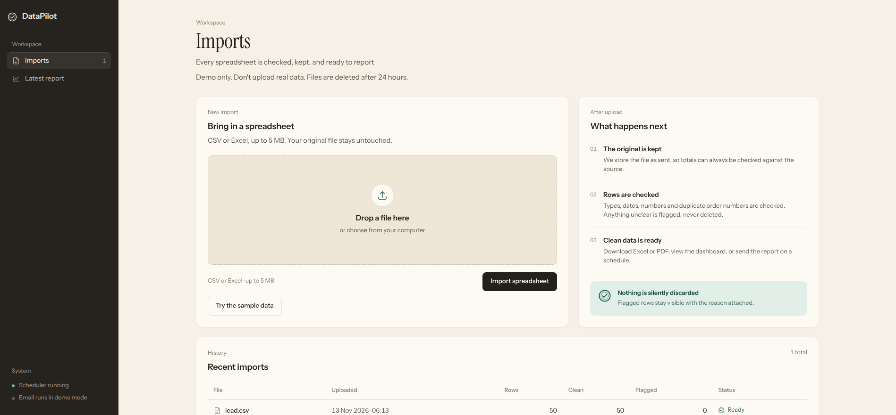

# DataPilot

Automated import, validation, and reporting for messy spreadsheets.

Upload a CSV or Excel file, keep the original, infer column types, flag rows that
break the pattern, then download Excel/PDF reports, view a Plotly dashboard, or
email the PDF on a daily or weekly schedule.

**Stack:** Flask, SQLAlchemy, PostgreSQL (JSONB), pandas, openpyxl, ReportLab,
APScheduler, Plotly.

## Demo

[](VIDEO_URL_HERE)

**[Watch the 90-second walkthrough](VIDEO_URL_HERE)**

The video covers: uploading a messy CSV, the flagged rows and inferred column
types, the dashboard, the Excel and PDF exports, and the email schedule screen.

## What it does

- **Keeps the original.** The uploaded file is stored untouched.
- **Infers column types** from the data instead of asking you to define a schema.
- **Flags, never drops.** Rows that break the pattern are marked with the reason,
  so nothing silently disappears.
- **Catches duplicate business keys** (`order_id`, `invoice_id`, and similar) and
  flags both the first occurrence and the repeat.
- **Reports from clean data only.** The dashboard and PDF aggregate valid rows, so
  bad data cannot distort a chart.
- **Excel export** with separate Summary, Clean data and Flagged sheets.
- **Scheduled email** of the same PDF, daily or weekly.

## Run it

```bash
docker compose up -d db
python3 -m venv .venv
source .venv/bin/activate
pip install -r requirements-dev.txt
cp .env.example .env
# set SECRET_KEY in .env, and SESSION_COOKIE_SECURE=0 for local HTTP
flask --app run.py run --debug
```

Open http://127.0.0.1:5000 and use the "Try the sample data" button, or upload
`sample_data/messy_sales.csv`.

## Tests

```bash
pytest
```

The pipeline and report tests need no Flask and no database. The app tests use a
temporary SQLite database, so they do not need the Docker Postgres container.

## Email

Set the SMTP values in `.env` to send real email. With `SMTP_HOST` empty, the app
writes `.eml` files to `outbox/` instead, which is enough to demo the flow.

Schedules are stored per import (recipients, daily/weekly, UTC hour). An in-process
APScheduler job checks every minute and attaches the same PDF the download button
produces. Run one process per database; multiple workers would each send. For a
larger deployment, move the job to a single worker or an external cron.

## Safety limits

This is a portfolio project, but it has basic guardrails:

- Each import belongs to a browser session. Every detail, dashboard, export,
  schedule and delete route checks the session, so one visitor cannot open
  another's data.
- Uploads: `.csv`, `.xlsx`, `.xls` only, 5 MB max, 20,000 rows and 100 columns max.
  Files are stored under random UUID names, never the uploaded filename.
- Imports and their stored files are deleted 24 hours after upload.
- Excel export escapes cells that start with `=`, `+`, `-` or `@` to prevent
  formula injection.
- Schedules: one recipient each, three per browser session, with address
  validation.
- `SECRET_KEY` is required from the environment, and session cookies are
  `HttpOnly`, `SameSite=Lax` and `Secure` by default.

## Deploying

`Procfile` runs a single Gunicorn worker on purpose because APScheduler runs
in-process:

```bash
gunicorn -w 1 -b 0.0.0.0:$PORT "app:create_app()"
```

Required environment variables: `SECRET_KEY`, `DATABASE_URL`,
`SESSION_COOKIE_SECURE` (defaults to on; set `0` only for local HTTP),
`ENABLE_SCHEDULER`, and the `SMTP_*` values if real email is wanted.

## Known limitations

- No user accounts. Isolation is per browser session, which suits a demo but not
  multi-user production use.
- `db.create_all()` creates tables at startup. Alembic migrations would replace it
  before any real deployment.
- `.xlsx` files are fully loaded by pandas, so very large or crafted workbooks can
  use a lot of memory. Size and row caps reduce the risk but do not remove it.
- The dashboard picks the first category column with 2 to 20 distinct values and
  the first numeric metric. This is a v1 heuristic.

## Structure

```
app/
  __init__.py        app factory, creates tables on startup (v1 only)
  config.py          env-backed configuration
  extensions.py      shared SQLAlchemy handle
  models.py          Import and ImportRow
  routes.py          HTTP layer only
  pipeline/
    extract.py       CSV/Excel -> DataFrame
    profile.py       infer column types
    validate.py      coerce cells, collect issues per row
    transform.py     safe cleaning (whitespace)
  reports/
    excel.py         Summary, Clean data, Flagged sheets
    analytics.py     valid-row aggregates for charts and PDF
    pdf.py           summary, totals, clean sample, flagged rows
    emailer.py       SMTP send, or .eml fallback
  scheduling.py      next-run arithmetic
  scheduler.py       in-process APScheduler job
  presentation.py    template filters for labels, numbers, dates
  templates/         Jinja views
  static/            stylesheet and upload interactions
tests/               pipeline, report, scheduling and app (session isolation,
                     upload validation) tests
```

## Design notes

- The original upload is stored under `uploads/` and referenced by
  `Import.stored_path`.
- Each data row is stored in `ImportRow.data` as JSONB, so unexpected columns are
  adopted automatically.
- Rows are flagged (`is_valid = false`, `issues` JSONB), not dropped.
- Text whitespace is normalized after validation; business values are not altered.
- Excel export separates clean rows from flagged rows so nothing is hidden.

## Interface

The UI follows one direction: a paper ledger with a rubber stamp on a desk in
morning light. It is meant to feel calm and exact for finance and operations
teams, not like generic admin software.

- Warm paper neutrals, a dark warm sidebar, one deep green accent and amber only
  for rows that need a second look.
- Instrument Sans for the interface and Instrument Serif for page titles.
- The double-ring check stamp is the signature, used beside clean counts, the
  brand mark and the report footnote.
- Status is written in words and a small stamp or dot, not color alone.
- The dashboard gives one main chart the weight, with a ranked breakdown beside it.
- Field names are humanized (`unit_price` becomes `Unit price`), numbers use one
  tabular format, and dates read as `13 Nov 2026`.
- Layout is responsive: a 252px sidebar on desktop, a compact top bar under 960px,
  and stacked panels on phones.
